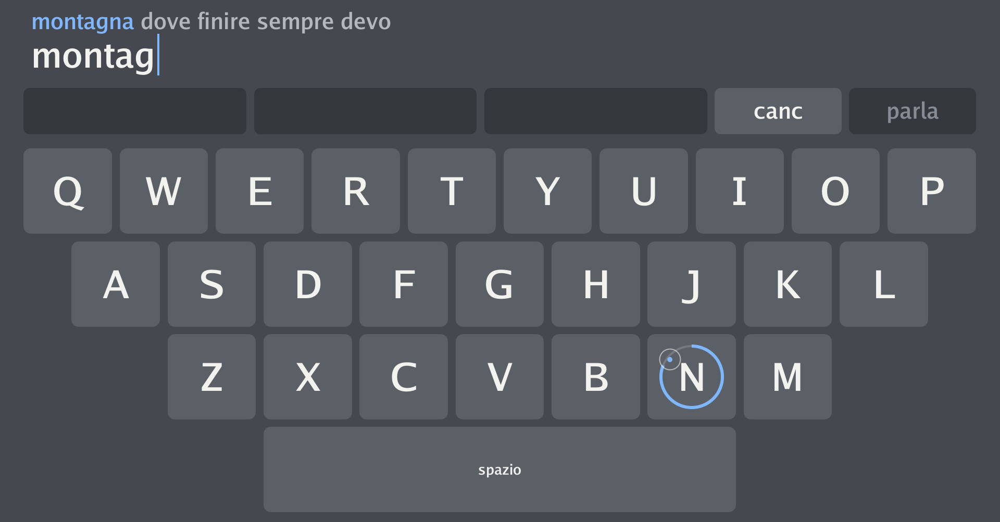

Part of [Kite](/en/research/kite/), my open Augmentative and Alternative Communication (AAC)
tool, is a **virtual keyboard operated with the eyes**. In this entry I describe how the first
version worked, the one I implemented at the start.

It was based on **dwell time**: you look at a key and keep your gaze on it for 1 second, until
the key "presses" itself. This is the **old approach** I implemented in Kite: I am now
studying a new mechanism, based on other factors, to make typing faster and the keyboard more
usable.

## Typing with the eyes, in brief

An **eye tracker** is a small bar with cameras and infrared illuminators mounted below the
screen. At every moment it estimates the point on the screen the person is looking at.

For people who cannot move their hands but still control their eyes, this point can act as a
pointer. The literature calls this technique *eye typing* or *gaze typing*. It has been studied
for a long time: already in 2002 a review traced twenty years of systems and design issues
([Majaranta and Räihä, 2002](#references)).

One clarification: an eye tracker **is not a Brain Computer Interface** (BCI). A BCI reads brain
activity, as I explain in the [entry on BCIs](/en/journal/what-is-a-brain-computer-interface/).
An eye tracker instead observes eye movement, which depends on the eye muscles. Many people with
severe motor disabilities retain precisely this movement, which is why gaze is one of the most
widely used channels in AAC.

## The "Midas Touch" problem

Pointing with the eyes is easy. The hard part is **clicking**. With a mouse you point and then
press a button; with gaze there is no button, because the eyes are also, and above all, used for
looking.

If the system pressed every key the gaze landed on, every glance would become a command. Robert
Jacob called this the **"Midas Touch"** problem, after King Midas: everywhere you look you
activate something, and you cannot look around without issuing a command
([Jacob, 1991](#references)).

Dwell time is the most common solution. When we look at something, the eyes stop on a point for
a short time, called a **fixation**, which usually lasts between 200 and 600 ms
([Majaranta et al., 2006](#references)). If the system requires a steady gaze much longer than a
normal fixation, it can tell "I am reading" apart from "I want to press". According to the same
source, 1000 ms is usually enough to prevent unintended selections.

## How Kite's old keyboard worked

To describe the old keyboard accurately I rely on the code of a Linux program in which I
reimplemented it. Everything below describes this reimplementation.

### Where the gaze comes from

The tracker is a **Tobii Eye Tracker 4C**, read by a Linux driver of mine at 90 samples per
second (90 Hz). Each sample contains the gaze point in screen coordinates.

The keyboard uses the gaze point provided by the Tobii 4C. It does not distinguish saccades
from fixations: it only checks which key the point falls on, sample after sample.

### From gaze to key

The mapping is purely **geometric**. Each key is a fixed rectangle on the screen, and the
candidate key is the one containing the gaze point. There is no prediction of the next letter:
all keys are treated the same way.

Between keys there is a small empty gap, equal to 8% of the key size. A gaze point falling in this
gap, or in the empty areas at the sides of the rows, belongs to no key.

### The 1-second timer

Sample by sample, the mechanism works like this:

1. When the gaze enters a key, that key becomes the **candidate** and the count starts from zero.
2. As long as the gaze stays on the candidate, the count grows. At each sample the time elapsed
   since the previous one is added, capped at 50 ms, so a gap in the data does not make the timer
   jump forward.
3. When the count reaches **1 s**, the key is activated and the letter enters the text.
4. If the gaze leaves the key for **no more than 100 ms**, the count is paused but not reset. This
   tolerates the jitter of the point near the edges.
5. If the gaze stays outside longer, the count is reset and the key being looked at becomes the
   candidate.
6. If the tracker loses the eyes, for example during a blink, the count is paused for up to
   **300 ms**. Beyond that threshold it is reset.
7. After an activation the count restarts from zero. Staying on the same key, the letter repeats
   after **another full second**.

In the program the dwell duration is a parameter; in the old keyboard it is 1 s.

### Visual feedback

While a key is being fixated, a faint **ring** appears around the letter. On top of the ring a
**coloured arc** fills clockwise, starting from the top, in proportion to the time already
elapsed: when the arc closes, the key is pressed. It is the same principle as the closing circle
used in a reference study on dwell time ([Majaranta et al., 2009](#references)).

*Kite's old keyboard while I type "montagna" (Italian for "mountain"): on the N key the blue
dwell-time arc is almost closed; the small circle is the gaze point.*

When a selection happens, the key flashes for 350 ms. In copy exercises, where the program knows
the phrase to be typed, the flash is green if the letter is right and red if it is wrong.

### Key layout

The keyboard is an on-screen **QWERTY** with 27 keys:

| Row | Keys | Offset from the left edge |
| --- | --- | --- |
| 1 | Q W E R T Y U I O P | none |
| 2 | A S D F G H J K L | half a key |
| 3 | Z X C V B N M | one and a half keys |
| 4 | space bar, 5 keys wide, below X…N | two and a half keys |

The keyboard spans almost the full width of the screen and roughly its lower two thirds. This
makes every key large, which matters: small targets are hard to hit with the eyes. Above the
keyboard there is a **delete** key (*canc*) to remove the last letter, pressed with
the same 1 s dwell.

Letters are lower case only and there is no punctuation. The old keyboard has no autocorrect and no
word suggestions. The program also offers an alternative alphabetical layout, on a grid of 3 rows
of 9 keys.

## What worked

- **Gaze alone is enough.** Dwell time does not require blinking or pressing a switch. For people
  with very severe motor disabilities, such as in the advanced stages of amyotrophic lateral
  sclerosis (ALS), residual muscle control may not be sufficient for these alternatives. This is
  why dwell-based selection remains the standard interaction for many of them
  ([Mott et al., 2017](#references)).
- **It is easy to understand.** "Look at the letter until the circle closes" can be explained in
  one sentence.
- **It respects pauses.** You can stop typing in the middle of a word to think or to look at the
  person you are talking to: you just move your gaze off the keyboard. Not all faster methods allow
  this ([Mott et al., 2017](#references)).
- **One second is cautious.** With 1 s, unintended selections become rare, because it is much
  longer than a normal fixation ([Majaranta et al., 2006](#references)).

## Limitations

### A ceiling on speed

The first limitation is mathematical. With a 1 s dwell you cannot press more than 60 keys per
minute, however skilled you become. In text entry one word is usually counted as 5 characters,
spaces included. The theoretical ceiling is therefore **12 words per minute** (WPM)
([Majaranta et al., 2006](#references)).

In practice typing is slower, because you also have to search for the letter and correct errors.
Studies with a fixed dwell time, typically between 450 and 1000 ms, report speeds of about
5–10 WPM ([Majaranta et al., 2009](#references)). For comparison, typing on a regular keyboard
reaches 40–60 WPM ([Mott et al., 2017](#references)).

### The speed–error trade-off

Shortening the dwell makes typing faster, but increases the risk of pressing a key just because you
were looking at it. Lengthening it protects against errors, but slows everything down. It is a
trade-off that designers and users have to negotiate ([Mott et al., 2017](#references)).

A fixed dwell makes this choice once and for all, for every key and every person. But people get
faster with practice. In a longitudinal study, 11 university students without disabilities, all
novices at gaze typing, could adjust the dwell themselves, starting from 1000 ms. Over 10 sessions of
15 minutes, analysed on 10 participants, the mean dwell dropped from 876 to 282 ms. Speed rose from
6.9 to 19.9 WPM and the error rate left in the text fell from 1.28% to 0.36%
([Majaranta et al., 2009](#references)). These results were obtained with other participants, another
tracker and another language: they say nothing measured on Kite. They do suggest, however, that a
fixed 1 s dwell can become a brake precisely for people who are learning.

### Search errors

Dwell does not fully eliminate the Midas Touch, it shifts it. If I stop to search for a letter, or to
think about the next word, with my gaze resting on a key for one second, that key gets pressed. The
same applies to the eye that stays still after a selection: the letter is repeated.

### Double letters cost double

In the old keyboard's code, repeating a letter takes another full second. To type "passare" (Italian
for "to pass") you have to stay 2 s on the S, or leave the key and come back.

### Fatigue

Keeping the gaze still for a long time is tiring. A prolonged fixation prevents wrong selections, but
is uncomfortable for most people ([Majaranta et al., 2006](#references)). In the same work, after four
sessions with a 900 ms dwell, all participants considered it too long, even though it had seemed
appropriate at the start. They reported that it tired their eyes and made it hard to concentrate.

### Tracker accuracy

The measured gaze point never coincides exactly with the real one. Because of how the eye works and
the limits of the camera, the accuracy of a remote tracker is about 0.5° of visual angle. With use,
the measured point also tends to move away from the real one (*drift*). In practice the error reaches
0.5–1°, that is 1–1.5 cm on the screen at a normal viewing distance
([Majaranta et al., 2006](#references)). This is why keys must be large, and why Kite's old keyboard
fills most of the screen.

## What I learned

A fixed 1 s dwell is a **solid** solution: it is robust, immediately understandable and works
with eye movement alone. But it imposes a hard ceiling on speed, treats every key and every moment
of typing the same way, and demands constant effort from the eyes.

For people who use AAC every day these limitations matter. In a conversation, waiting for a sentence
typed at a few characters per minute often means missing the right moment to say it.

> **Disclaimer.** Kite is an experimental project and **is not a certified medical device**. Anyone
> who depends on an AAC tool to communicate should always have a backup option, for example a paper
> alphabet board. Tests with people require informed consent and, where needed, approval from an
> ethics committee.

## References

1. Jacob R. J. K. (1991). The use of eye movements in human-computer interaction techniques: what
   you look at is what you get. *ACM Transactions on Information Systems*, 9(2), 152–169.
   [doi:10.1145/123078.128728](https://doi.org/10.1145/123078.128728)
2. Majaranta P., Ahola U.-K., Špakov O. (2009). Fast gaze typing with an adjustable dwell time. In
   *Proceedings of the SIGCHI Conference on Human Factors in Computing Systems (CHI '09)*, 357–360. ACM.
   [doi:10.1145/1518701.1518758](https://doi.org/10.1145/1518701.1518758).
   [Open access version](https://homepages.tuni.fi/oleg.spakov/publications/Majaranta_CHI_09.pdf)
3. Majaranta P., MacKenzie I. S., Aula A., Räihä K.-J. (2006). Effects of feedback and dwell time on
   eye typing speed and accuracy. *Universal Access in the Information Society*, 5(2), 199–208.
   [doi:10.1007/s10209-006-0034-z](https://doi.org/10.1007/s10209-006-0034-z).
   [Open access version](https://www.yorku.ca/mack/UAIS2006.pdf)
4. Majaranta P., Räihä K.-J. (2002). Twenty years of eye typing: systems and design issues. In
   *Proceedings of the Symposium on Eye Tracking Research & Applications (ETRA '02)*, 15–22. ACM.
   [doi:10.1145/507072.507076](https://doi.org/10.1145/507072.507076)
5. Mott M. E., Williams S., Wobbrock J. O., Morris M. R. (2017). Improving dwell-based gaze typing
   with dynamic, cascading dwell times. In *Proceedings of the 2017 CHI Conference on Human Factors in
   Computing Systems (CHI '17)*, 2558–2570. ACM.
   [doi:10.1145/3025453.3025517](https://doi.org/10.1145/3025453.3025517).
   [Open access version](https://faculty.washington.edu/wobbrock/pubs/chi-17.02.pdf)
